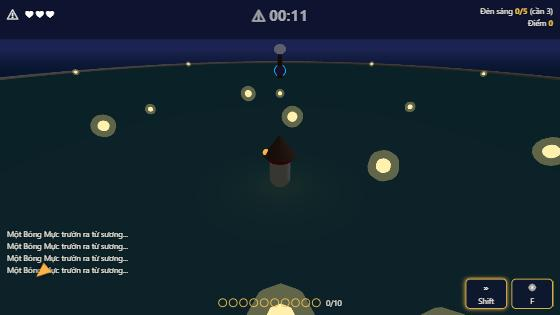

# Đảo Đèn Lồng

> **Video demo:** _chưa có_ — kịch bản quay nằm ở [docs/demo/DEMO.md](docs/demo/DEMO.md); link sẽ đặt ở đây khi video được đính kèm Release `v1.0.0`.
> Đề bài lab gốc: [LAB-README.md](LAB-README.md) · Ghi chép: [docs/notes](docs/notes) · Bằng chứng: [docs/proof](docs/proof/README.md) · [CHANGELOG](CHANGELOG.md)



Game 3D góc nhìn thứ ba. Bạn là **Mây**, người giữ đèn nhỏ tuổi: gom đom đóm, giữ các **Đèn Lồng Lớn** trên ba hòn đảo sáng tới bình minh và né **Bóng Mực** trong sương đen. Phiên bản **v1.0.0** (Test Contract v1.3).

## Yêu cầu hệ thống

- Python 3.9 trở lên (chỉ dùng thư viện chuẩn, **không cài thêm gì**).
- Trình duyệt hiện đại có WebGL (Chrome, Edge, Firefox, Safari). Benchmark cần Chrome/Chromium/Edge.
- macOS, Linux hoặc Windows. Màn hình tối thiểu 1280×720.

## Cài đặt và chạy (2 lệnh)

```
git clone <repo> && cd <repo>
python3 -m game.server        # rồi mở http://localhost:8000   (Windows: python, hoặc play.bat)
```

Bản phát hành (Release `v1.0.0`) là file zip: giải nén rồi chạy `python3 -m game.server` (hoặc `play.sh` / `play.bat`).

## Điều khiển (đổi được trong Cài đặt → Đổi phím)

| Phím mặc định | Việc |
|---|---|
| W A S D | Di chuyển (theo hướng camera) |
| Space | Nhảy |
| Shift | Lướt (14 m/s trong 0.2 s, hồi 1.5 s) |
| E | Nạp ánh sáng vào đèn tắt hoặc châm dầu cho đèn đang sáng (trong 2 m) |
| F | Tỏa Sáng: choáng và đẩy lùi Bóng Mực trong 5 m (tốn 3 đom đóm, hồi 3 s) |
| Esc | Tạm dừng (Tiếp tục, Chơi lại Đêm, Cài đặt, Về menu) |
| Kéo chuột / ← → | Xoay camera |

Cài đặt: âm lượng, độ nhạy chuột, bảng màu dễ phân biệt, giảm chuyển động (tắt rung camera và chớp màn hình), chữ lớn ×1.25, đổi phím (có báo trùng phím và "Khôi phục mặc định"). Tất cả được lưu. Có phụ đề/chỉ báo hình ảnh cho Bóng Mực xuất hiện (mũi tên tím), gió sắp thổi, 10 giây cuối và đèn sắp cạn dầu.

## Luật

- Ba Đêm: **Đảo Bến** (5 đèn, 240 s), **Đảo Cau** (hai đảo nối cầu tre, bục nhảy, Bùa Gió, Gió Lạc; 6 đèn, 270 s), **Đảo Chuông** (3 tầng, dốc, tháp, gió mạnh; 7 đèn, 300 s). Thắng Đêm 3 là màn Bình Minh; thua thì chơi lại Đêm đó.
- **Mục tiêu: giữ đảo sáng tới bình minh.** Thắng khi Mây còn sống lúc hết giờ và số đèn đang sáng ≥ 60% (3/5, 4/6, 5/7). Thắp đủ đèn không kết thúc Đêm.
- **Đèn có dầu:** thắp lần đầu cần 10 đom đóm, dầu 100 và hao 1/s; bấm E ở đèn đang sáng để châm dầu (10 dầu mỗi đom đóm). Hết dầu đèn tắt, thắp lại chỉ cần 5 đom đóm. Đèn dầu < 30 mất vùng an toàn và nhấp nháy; **Bóng Mực** đi lang thang sẽ tới hút dầu (5/s) đèn yếu.
- Sức chứa đom đóm = 10 + 2 × số lần thắp thành công (tối đa 20).
- Nhặt đom đóm (≤ 1 m). Bóng Mực chạm vào: −1 Ngọn Lửa (có 3), rơi một nửa đom đóm đang mang, bất tử 1.5 s. Rơi khỏi đảo: −1 Ngọn Lửa, mất hết đom đóm, hồi sinh sau 1 s. Đèn sáng có dầu ≥ 30 có vùng an toàn bán kính 6 m.
- **Gió Lạc** cướp tối đa 3 đom đóm của người mang ≥ 5; Tỏa Sáng đuổi nó và lấy lại đồ. **Bùa Gió** (10 s): chạy 7.2 m/s, lướt không hồi chiêu.
- Điểm: +5 mỗi đom đóm nạp/châm, +100 thắp lần đầu, +40 thắp lại, +5 mỗi Bóng Mực trúng Tỏa Sáng (+15 nếu nó đang hút dầu); bình minh (khi thắng): +50 + dầu cho mỗi đèn sáng và +50 mỗi Ngọn Lửa còn lại. Tổng điểm là tổng các Đêm đã thắng.
- **Bảng xếp hạng** (menu chính): top 10 lưu trên đĩa (`data/leaderboard.json`); nhập tên 3–12 ký tự (chữ, số, `_`) sau Bình Minh hoặc khi thua. Xuất: `python3 -m game.server --export-leaderboard out.json`.

Số liệu chuẩn: [game.contract.json](game.contract.json). Spec: [phase 2](docs/notes/spec-phase2.md), [phase 3](docs/notes/spec-phase3.md), [phase 4](docs/notes/spec-phase4.md). Quyết định thiết kế: [ADR-0003](docs/notes/ADR-0003-fuel-and-dawn-rule.md). Giả định: [assumptions.md](docs/notes/assumptions.md).

## Test, headless, benchmark, soak

```
python3 -m unittest discover -s tests -q      # 89 test
python3 tests/run_proof.py                    # 20 scenario, tính tất định, đo 1 Đêm; ghi docs/proof/phase3
python3 -m game.headless --seed 1 --night 1 --ticks 600 --out out.jsonl [--scenario f.json] [--inputs f.json] [--snapshot-every 10]
python3 -m game.bench --seed 42 --duration 30 --out bench.json
python3 -m game.soak  --seed 7  --nights 10   --out soak.json
```

- **Headless** theo Test Contract (60 tick/s, `--night 1|2|3`, JSONL snapshot / event / end, `pause`, file hỏng → exit 2). Một Đêm đầy đủ chạy trong vài giây. Logic nằm hoàn toàn trong `game/sim.py`; server, headless, soak và bench dùng chung nó.
- **Benchmark:** mở cửa sổ trình duyệt thật 1280×720 với cảnh chuẩn (Đêm 1, 200 Bóng Mực, 100 đom đóm, camera quay), khởi động 3 s rồi đo `--duration` giây, ghi `bench.json`. Tự tìm Chrome/Edge/Chromium; chỉ định bằng `--browser PATH` hoặc `BENCH_BROWSER`. **Lưu ý:** bản chơi là web nên không tắt được vsync từ trang; lệnh truyền `--disable-gpu-vsync --disable-frame-rate-limit` cho trình duyệt (`vsync_off: true` theo cờ này, không kiểm chứng được). Mỗi khung chờ GPU xong (`readPixels`) để dt phản ánh thời gian thật. `peak_mem_mb` là tổng bộ nhớ của cây tiến trình trình duyệt. Kết quả đo trên máy làm bài: [docs/proof/phase4/bench.json](docs/proof/phase4/bench.json) (chỉ để tham khảo).
- **Soak:** 10 Đêm liên tiếp (xoay vòng 1→2→3, seed 7+i, input ngẫu nhiên theo seed) trong một tiến trình, kiểm `crashes = 0` và bộ nhớ không tăng quá 20%. Kết quả: [docs/proof/phase4/soak.json](docs/proof/phase4/soak.json).

## Sáng tạo của tôi

**Đom đóm vàng** (chỉ trong bản chơi): mỗi 25 s một đom đóm vàng lớn xuất hiện, nhặt được 3 ánh sáng một lần. Bật bằng `Sim(extras=True)` và RNG riêng; tắt trong headless, soak và benchmark nên đầu ra Test Contract không đổi. Bằng chứng: các test dùng `Sim` mặc định (extras tắt), `run_proof.py` tất định, và `Sim(bench=True)` ép `extras=False`.

## Harness AI

[AGENTS.md](AGENTS.md), skill [.claude/skills/verify](.claude/skills/verify/SKILL.md), hook `Stop` chạy test ([.claude/settings.json](.claude/settings.json)), CI [.github/workflows/test.yml](.github/workflows/test.yml). Nhật ký dùng AI và retro: [docs/notes/ai-log.md](docs/notes/ai-log.md), [docs/notes/retro.md](docs/notes/retro.md).

## Giấy phép

MIT ([LICENSE](LICENSE)). Nguồn asset và công cụ AI: [CREDITS.md](CREDITS.md).
